# Foody Food Delivery

根据 Pixso《Foody UI Kit》浅色版设计稿实现的 Flutter 外卖应用。设计文件包含 33 张手机画板与 Colors / Character Style / Components 三张规范板，本项目用可交互控件还原了其中的注册、地址、试用、首页、自取、优惠、搜索、店铺、商品、购物车、结算、订单、评价、促销与礼品卡等全部界面。界面沿用设计稿的英文文案、Urbanist 字体与珊瑚橙 / 青绿配色。另按 Pixso《UI Kit dark version》暗色设计稿实现整套暗色主题，可在账户页一键切换。

## 主要界面

| 首页 | 店铺详情 | 商品详情 |
| --- | --- | --- |
| 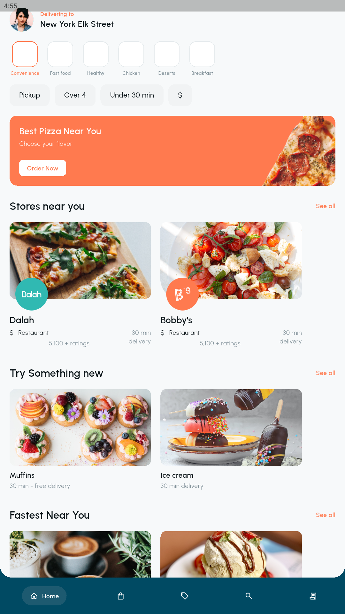 | 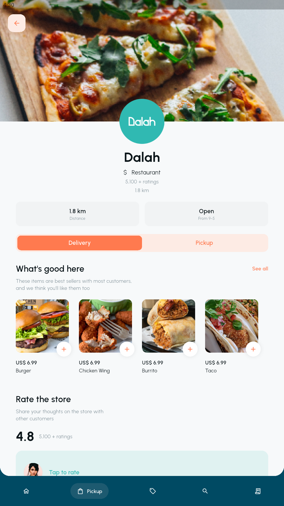 | 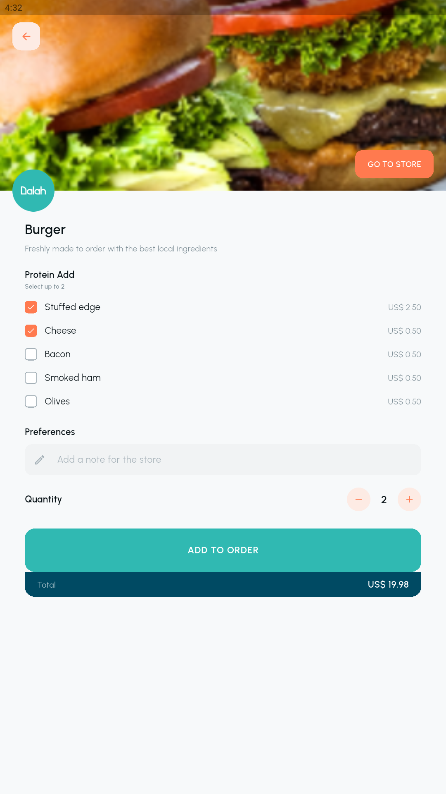 |
| **购物车** | **配送结算** | **订单** |
| 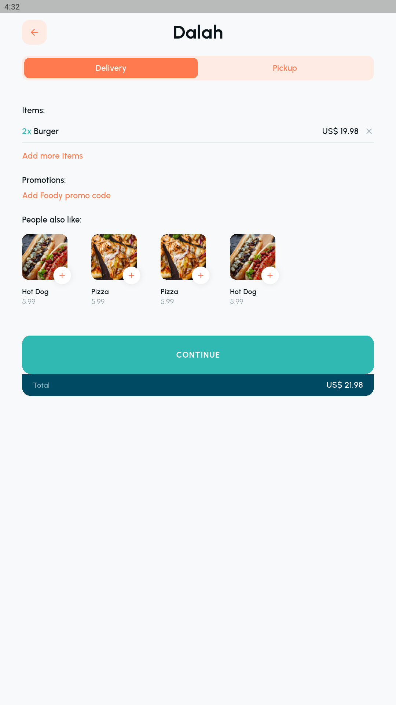 | 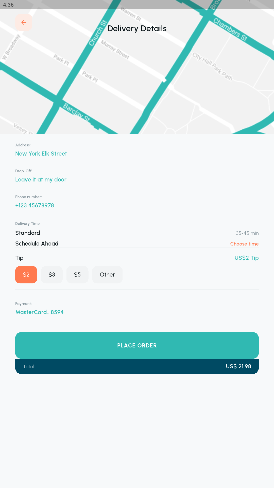 | 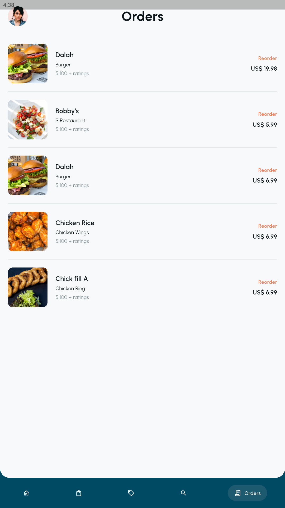 |
| **自取地图** | **优惠轮播** | **搜索结果** |
| 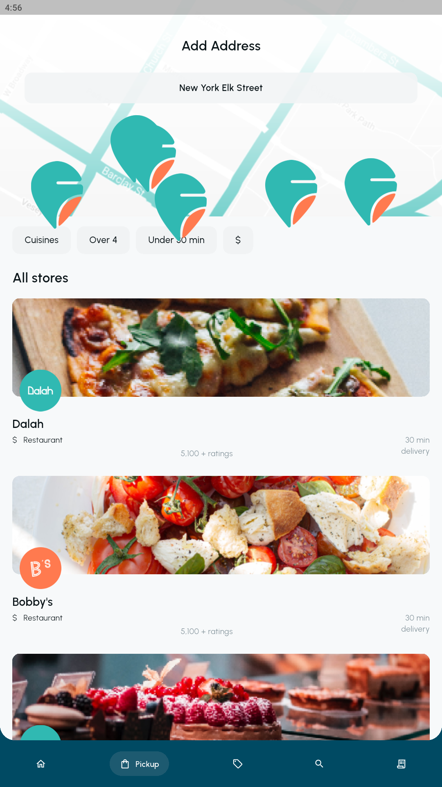 | 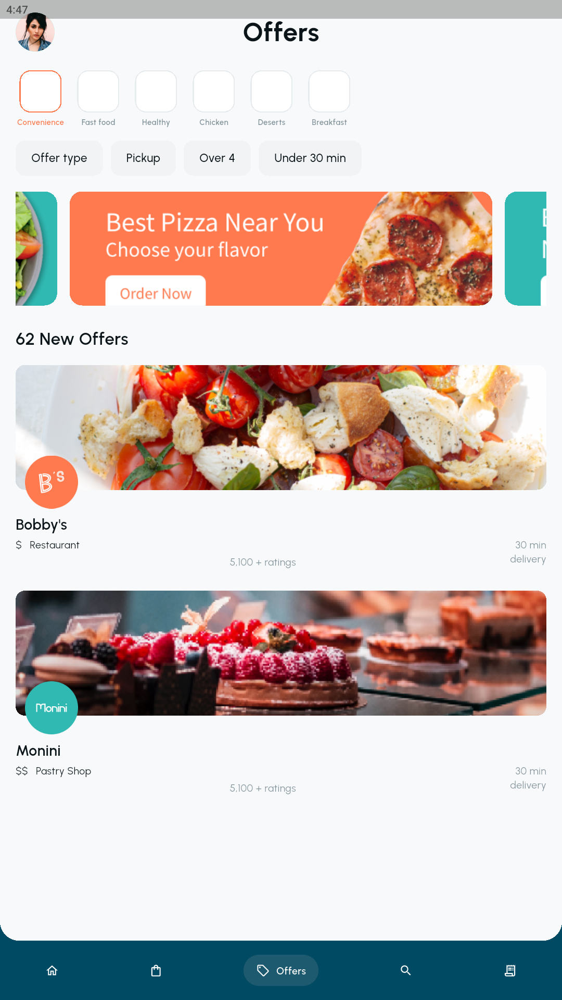 | 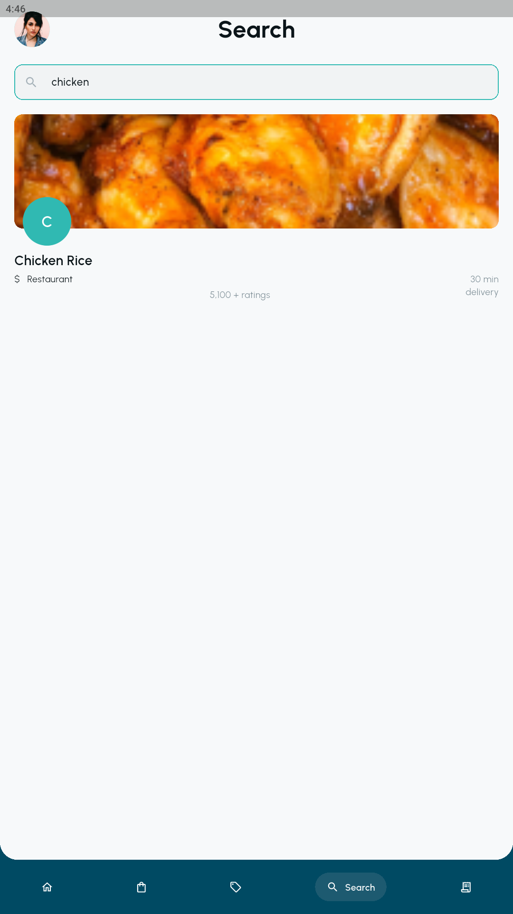 |
| **促销与礼品卡** | **礼品卡定制** | **账户** |
| 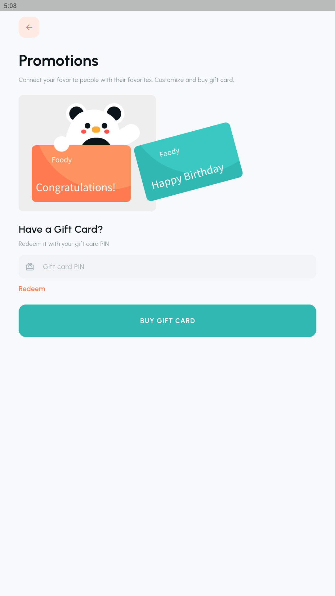 | 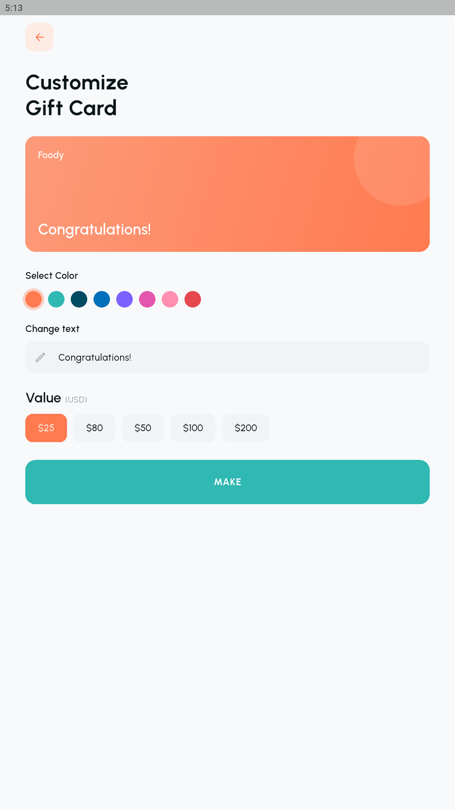 | 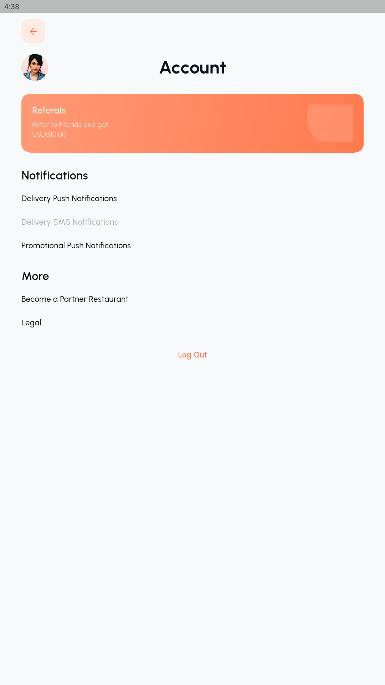 |

[全部 37 张界面截图与 Pixso 画板节点对应表](docs/screenshots.md)

## 暗色主题

按 Pixso《UI Kit dark version》（36 张 375 × 812 画板）还原：入口为 **Account → More → Dark Mode** 开关，切换后全局即时生效（含弹层、地图头与礼品卡）。

| 首页 | 店铺详情 | 商品详情 |
| --- | --- | --- |
| 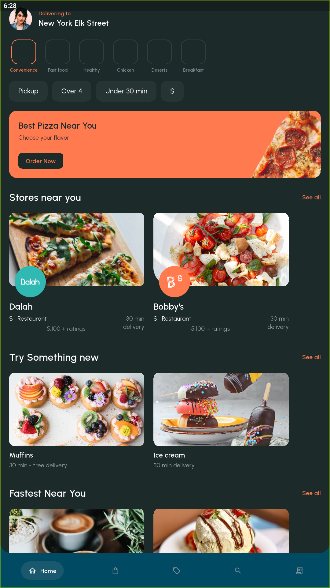 | 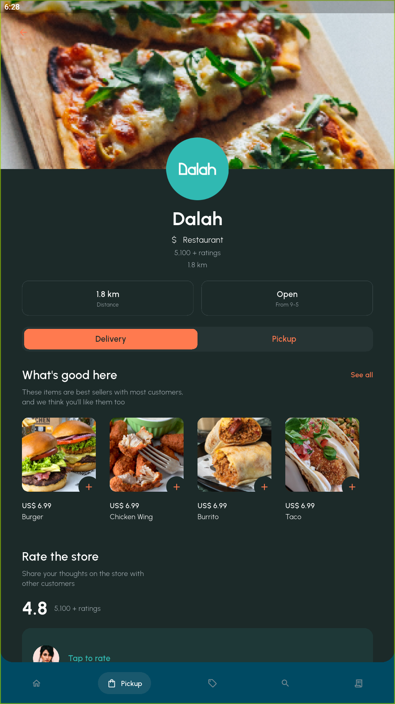 | 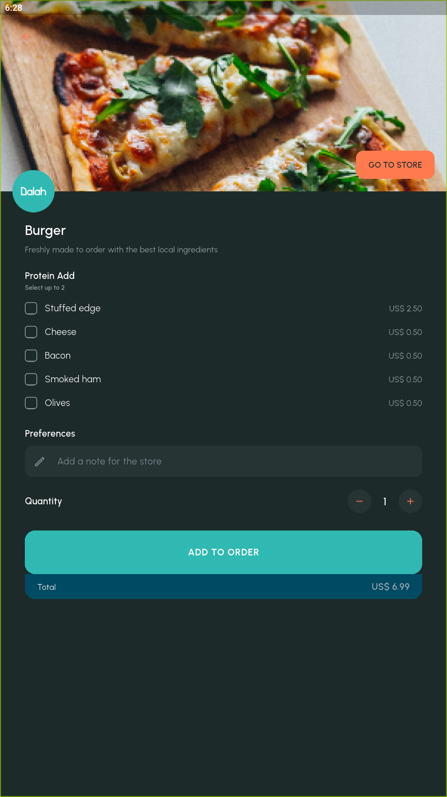 |
| **购物车** | **配送结算** | **账户** |
| 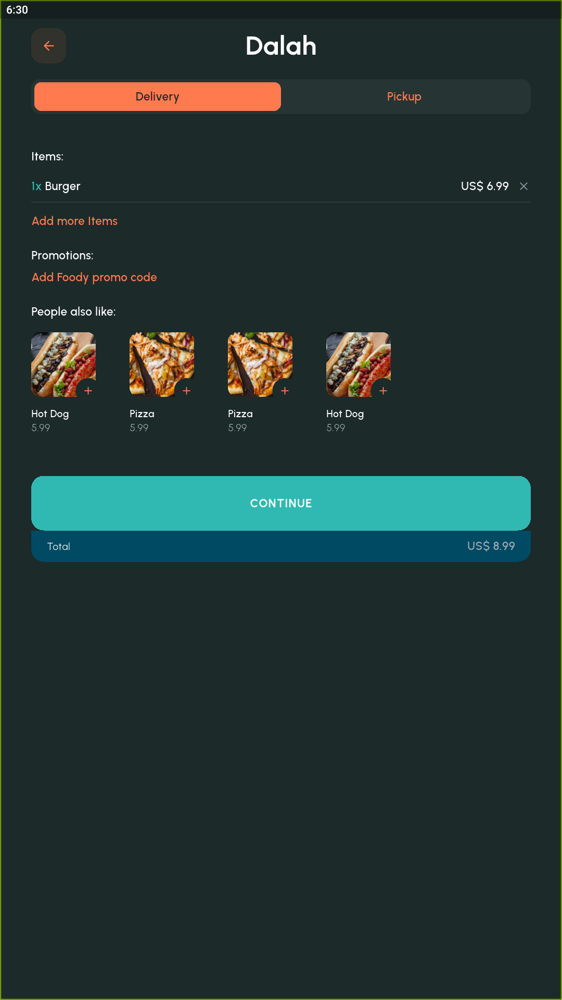 | 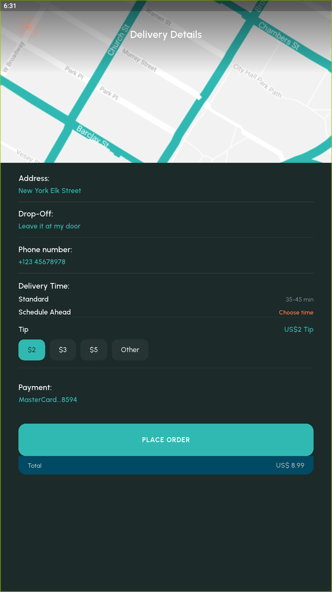 | 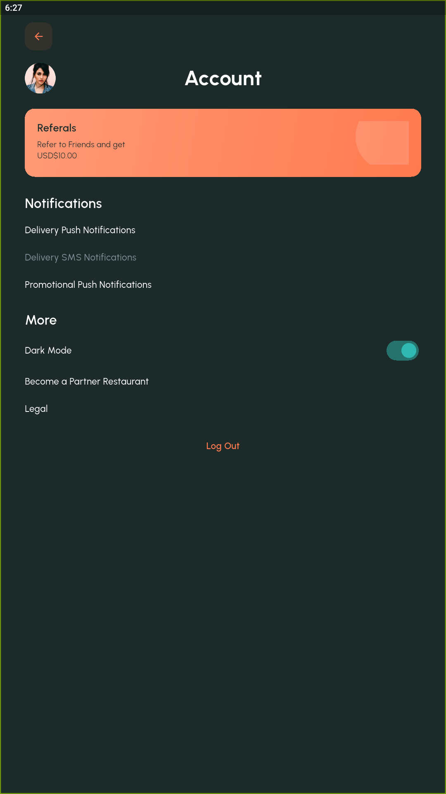 |

- 令牌：bg / surface `#1C2A29`、标题白、正文 `#9FAAAF`、次级 `#7F8F97`、field `#263434`、line `#303E3F`；coral / teal / petrol 品牌色不变。设计稿中 10% / 20% 透明灰按底色混合落地为 field / line。
- 细节：珊瑚橙 / 青绿上的文字改用 `#1C2A29`（teal 主按钮除外，仍为白字）；小费选中 chip 为 teal；VIEW CART 圆钮用深青 `#26948E`；店铺信息卡改为透明 + 描边；地图头顶部叠加黑 54% → 透明渐变；礼品卡浅色卡面自动换深色文字、色板选中加 field 圆环。
- 机制：`theme.dart` 的 `F.dark` + 角色色 getter（`ink` / `bg` / `field` / `line` / `onAccent` 等），`FoodyStore.darkMode` 经 `InheritedNotifier` 驱动全树重建，`MaterialApp.themeMode` 同步切换；退出登录不重置主题偏好。
- 参考与实跑截图：`docs/design-dark/`（Pixso 导出）、`docs/screenshots-dark/`（13 张模拟器实跑）。

## 功能范围

| 模块 | 界面 | 说明 |
| --- | --- | --- |
| 启动与注册 | Splash、三页引导、Sign Up、Add Address（搜索 + 地图确认）、Try Foody 试用、首选支付弹层、Add Card、Favorites | 引导可跳过；注册与地址表单本地校验；试用开启后弹首选支付弹层 |
| 首页与发现 | Home、Pickup（地图 pins + Cuisines 展开）、Offers（卡片轮播）、Search（建议 + 结果） | 分类、评分、价格、30 分钟、自取等筛选全局生效并联动列表 |
| 店铺与商品 | Store details（菜单 / 评分 / 信息）、Item details（加料、数量、备注） | 加购合并同商品同加料；店铺底部评分入口与 VIEW CART |
| 购物车与结算 | Cart（Delivery / Pickup）、Delivery Details、Pickup Details、Tip、Payment、Add Card 弹层 | 小计 + 小费 / 自取免小费；促销码立减；下单写入订单列表 |
| 订单与评价 | Orders、Account、Add a Review（空 / 已填）、Thank you | 再次下单回填购物车；评价提交后更新店铺评分；退出重置会话 |
| 促销与礼品卡 | Enter promo code、Promotions（PIN 兑换）、Customize Gift Card | 8 色卡面、自定义文案、5 档面额，生成后计入本地礼品卡列表 |

## 项目结构与架构

```text
lib/
  main.dart               入口：MaterialApp、命名路由 /shell、MainShell（底部导航 + IndexedStack）
  store.dart              FoodyStore(ChangeNotifier) + FoodyScope(InheritedNotifier)；店铺/商品/订单/礼品卡演示数据
  theme.dart              F 设计令牌（色板、字阶）、push/pop/toast/usd 工具
  ui.dart                 共享组件：按钮、输入框、chips、店铺/商品卡、底部导航、地图头、弹层骨架、滑杆等
  screens/
    onboarding.dart       Splash、三页引导
    auth.dart             注册、地址搜索与地图、试用、收藏
    discover.dart         Home、Pickup、Offers、Search
    store_screen.dart     店铺详情、商品详情
    cart.dart             购物车、Delivery/Pickup 结算、Add Card
    sheets.dart           评分/价格/支付/小费/放置/时间/优惠类型弹层
    orders.dart           订单、账户
    review.dart           评价、Thank you
    promo.dart            促销码、Promotions、礼品卡定制
assets/                   Pixso 导出插画、店铺/商品图、地图与 Urbanist 字体
docs/
  design/                 36 张浅色设计参考图（2x 导出）
  design-dark/            8 张暗色设计参考图（Pixso 暗色稿导出）
  screenshots/            37 张模拟器实跑截图（浅色）
  screenshots-dark/       13 张模拟器实跑截图（暗色）
  screenshots.md          截图 ↔ Pixso 画板节点索引
artifacts/                Android ARM64 release APK
android/  ios/  web/      Flutter 平台入口
```

状态集中在 `FoodyStore`：购物车、地址、配送/自取模式、小费、支付、筛选、订单、评价、礼品卡与通知开关都在其中，页面通过 `FoodyStore.of(context)` 读写，`ChangeNotifier` + `InheritedNotifier` 驱动刷新，无第三方状态库。导航用 `Navigator` 的 push/pop 封装（`theme.dart`），底部五个 tab 由 `MainShell` 的 `IndexedStack` 保持各页状态，`goTab` 先 pop 回 `/shell` 再切 tab。所有底部弹层统一走 `foodySheet`（`showModalBottomSheet` + 共享骨架）。

## 设计还原

- 色板：ink `#0B1519`、coral `#FF7A4F`、teal `#30B9B2`、petrol `#004A63`、bg `#F7F9FA`、field `#F1F3F4`、line `#E6EBED` 等，集中在 `theme.dart` 的 `F`；暗色角色色见上文暗色主题一节。
- 字体：Urbanist Regular–ExtraBold 随包内置；字阶 h1 34/41 至 body2 13/18 按 Character Style 规范板落地。
- 画板为 360 × 780 逻辑尺寸（参考图 2x 导出）；组件按设计逻辑尺寸固定布局，在 720 逻辑宽模拟器上留白而非拉伸。
- 插画、店铺/商品照片、地图与头像来自设计素材；少量小图标用 Material Icons 近似。

## 本地运行

[下载 Android ARM64 演示 APK](artifacts/Fohan-android-arm64.apk)（约 25.2 MB，release 构建、调试密钥签名，仅用于演示）。

```sh
flutter pub get
flutter run -d <device-id>     # flutter devices 查看已连接设备/模拟器
```

Chrome 可直接 `flutter run -d chrome`。重新构建演示包：`flutter build apk --release --target-platform android-arm64`。iOS 入口在 `ios/`，需 macOS + Xcode。

## 交付与限制

- 演示数据保存在内存中，重启即重置；无后端、无网络请求。
- 地图为设计静态素材，pins 与定位装饰性展示；无真实定位与路径规划。
- 支付、加卡、促销码（任意非空码立减 US$ 2.00）、礼品卡 PIN 兑换均为本地演示逻辑，不发生真实扣款。
- 订单状态、评价与通知开关仅本地生效；短信/邮件/第三方登录未接入。
- 验证：`flutter analyze` 无问题；emulator-5554（720 × 1280 逻辑像素）实跑注册 → 地址 → 试用 → 首页 → 加购 → 结算 → 下单 → 评价 → 促销 → 礼品卡全流程，37 张浅色截图均取自该模拟器；暗色主题另实跑切换并逐屏核对暗色设计稿，13 张暗色截图见 `docs/screenshots-dark/`。